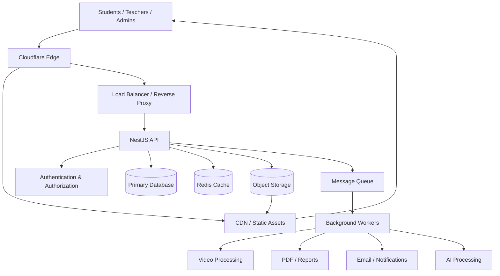
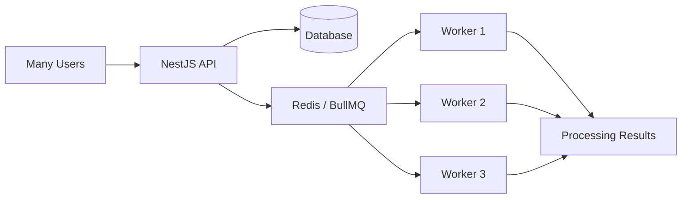
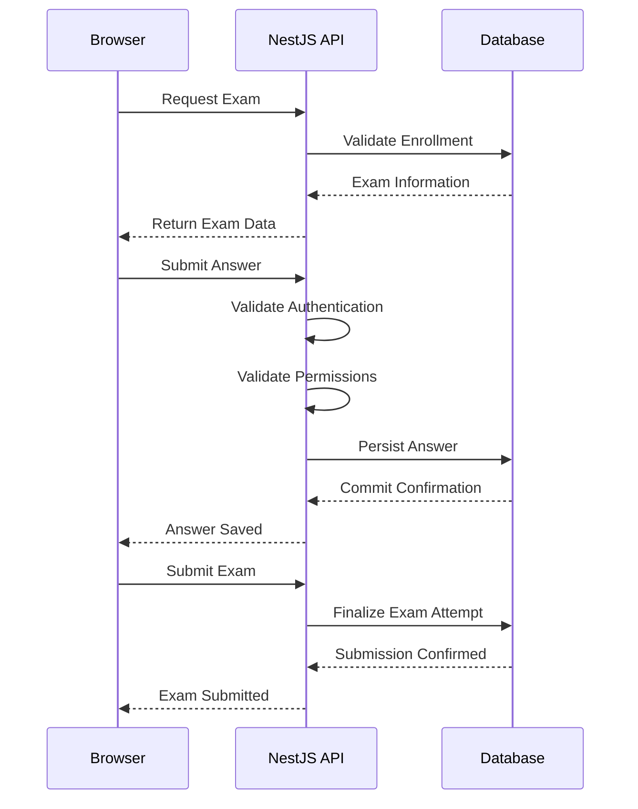
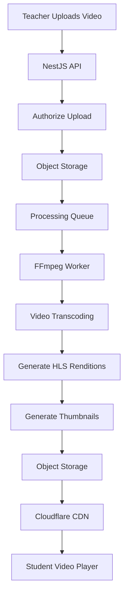
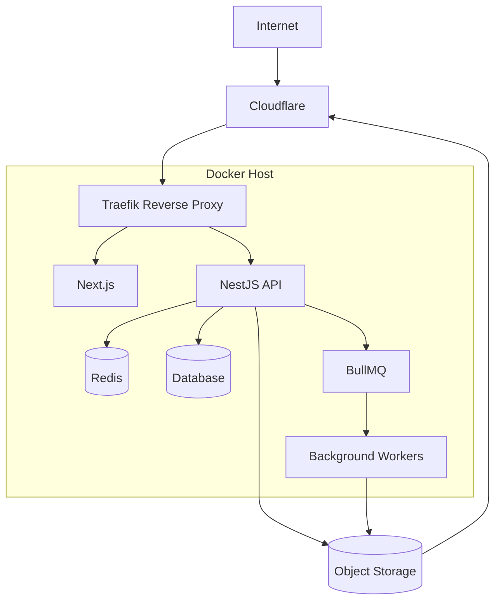

# Scalable LMS Platform Architecture

> **Status:** Planning / Architecture Proposal  
> **Document Type:** Technical Architecture & Implementation Reference  
> **Last Updated:** November 10, 2026  
> **Project:** Future TechAxon LMS

---

## 1. Purpose and Goals

This document describes a scalable architecture for a modern Learning Management System (LMS).

The goal is to design a platform that can handle thousands or potentially hundreds of thousands of concurrent users while maintaining performance, reliability, security, and reasonable infrastructure costs.

The architecture focuses on:

- Handling sudden traffic spikes.
- Supporting thousands of simultaneous students.
- Delivering video and educational content efficiently.
- Processing resource-intensive tasks asynchronously.
- Maintaining reliable exam and grading workflows.
- Scaling backend services independently.
- Reducing infrastructure costs.
- Supporting future growth without unnecessary complexity.

### Core Principle

**Design for scalability, but introduce complexity only when the product needs it.**

Start with a Modular Monolith architecture and evolve toward distributed services only when real requirements justify the transition.

---

## 2. Architecture Principles

The platform should follow these principles:

1. **Hybrid Architecture:** Distribute workloads between Client-side, Edge, Backend, Background Workers, and Storage.
2. **Backend Authority:** Critical business logic must always be validated and executed server-side.
3. **Asynchronous Processing:** Long-running and CPU-intensive operations should not block API requests.
4. **Caching:** Reduce unnecessary database queries and improve response times.
5. **CDN First:** Deliver static assets and media through a CDN rather than application servers.
6. **Horizontal Scalability:** Allow API instances and workers to scale independently.
7. **Fault Tolerance:** Handle failures using retries, timeouts, idempotency, and graceful degradation.
8. **Observability:** Monitor infrastructure, application performance, and bottlenecks.
9. **Security by Design:** Protect authentication, authorization, user data, and educational records.
10. **Cost Efficiency:** Avoid overengineering before the platform has real traffic.

---

## 3. High-Level System Architecture

The proposed architecture consists of the following components:

- Client Applications
- CDN and Edge Network
- Load Balancer / Reverse Proxy
- Backend API
- Database
- Cache
- Message Queue
- Background Workers
- Object Storage
- Monitoring and Observability

### Architecture Diagram



---

## 4. Workload Distribution

Not every operation should run on the same infrastructure.

The most important architectural decision is to place each workload in the environment where it performs best.

### 4.1 Client-side Processing

The browser should handle operations that improve user experience and do not require trusted execution.

Recommended operations:

- UI rendering.
- Form validation.
- Client-side filtering and sorting.
- Video playback.
- Document previews.
- Lightweight calculations.
- Interactive learning components.
- Web Workers for suitable background browser tasks.
- WebAssembly for selected CPU-intensive browser operations.

Avoid performing authoritative operations on the client:

- Final exam grading.
- Authorization decisions.
- Payment verification.
- Exam deadline enforcement.
- Critical business calculations.
- Sensitive data validation.

The browser is an untrusted environment. Any critical operation must be validated by the backend.

### 4.2 Edge Computing

Use Cloudflare for operations that benefit from distributed infrastructure.

Recommended responsibilities:

- CDN content delivery.
- Static asset caching.
- TLS termination.
- WAF protection.
- Rate limiting.
- Bot protection.
- Lightweight request routing.
- Edge-side authentication checks where appropriate.
- Caching public or safely cacheable responses.

Cloudflare Workers can execute lightweight application logic close to users.

However, Workers should not be treated as a general-purpose replacement for CPU-intensive processing infrastructure.

Video transcoding and heavy computational jobs should run on dedicated workers or suitable processing services.

### 4.3 Backend Processing

The backend is responsible for authoritative business logic.

Recommended responsibilities:

- Authentication.
- Authorization.
- User management.
- Course management.
- Enrollment management.
- Exam management.
- Answer persistence.
- Grade calculation.
- Payment processing.
- Learning progress tracking.
- Administrative operations.
- API endpoints.
- Audit logging.

The backend should avoid executing long-running tasks directly inside HTTP request handlers.

Instead, it should enqueue background jobs when appropriate.

### 4.4 Background Workers

Background workers handle operations that are time-consuming, CPU-intensive, or asynchronous.

Examples:

- Video transcoding.
- Video compression.
- Thumbnail generation.
- PDF generation.
- Certificate generation.
- Bulk imports and exports.
- Email delivery.
- Notifications.
- Report generation.
- AI-based content processing.

Workers should be independently scalable.

For example, video processing may require substantial CPU resources, while email workers require relatively little compute.

### 4.5 Database, Cache, and Storage

**Database**

Stores durable application information:

- Users.
- Courses.
- Lessons.
- Enrollments.
- Exams.
- Answers.
- Grades.
- Payments.
- Learning progress.

**Redis**

Used for:

- Caching.
- Rate limiting.
- Temporary state.
- Session-related data where appropriate.
- Queue infrastructure.
- Distributed coordination.

**Object Storage**

Stores large files:

- Videos.
- Images.
- Documents.
- Course attachments.
- Generated PDFs.
- Exports.

**CDN**

Distributes static content and authorized media efficiently.

---

## 5. Recommended Technology Stack

The following stack is a practical starting point.

| Component | Technology |
|---|---|
| Frontend | Next.js |
| Backend | NestJS |
| Edge / CDN | Cloudflare |
| Reverse Proxy | Traefik |
| Database | PostgreSQL or CouchDB |
| Cache | Redis |
| Message Queue | BullMQ |
| Object Storage | S3-compatible Storage |
| Video Processing | FFmpeg |
| Video Streaming | HLS / DASH |
| Containers | Docker |
| Monitoring | Prometheus |
| Dashboards | Grafana |
| Load Testing | k6 |
| Distributed Tracing | OpenTelemetry |

### Database Selection

PostgreSQL is a strong default for LMS platforms because educational systems frequently require:

- Relational data.
- Transactions.
- Referential integrity.
- Complex reporting.
- Consistent exam submissions.
- Reliable grade management.

CouchDB is also a valid option when its document-oriented model, replication capabilities, and operational characteristics fit the application's requirements.

The database decision should be based on actual access patterns, consistency requirements, and reporting needs.

Avoid introducing multiple databases without a clear architectural reason.

---

## 6. Handling Traffic Spikes

A traffic spike occurs when a large number of users access the platform within a short period.

Examples:

- 20,000 students opening the same course.
- Thousands of users starting an online exam simultaneously.
- A live lesson beginning.
- A registration deadline.
- A notification causing many users to visit the same page.

The challenge is not only the number of concurrent users.

It also depends on:

- Requests per second.
- Database query complexity.
- CPU utilization.
- Memory consumption.
- Network bandwidth.
- Cache hit ratio.
- Number of simultaneous writes.

### 6.1 API Protection

Recommended techniques:

- Cloudflare CDN.
- Web Application Firewall.
- Rate limiting.
- Request size limits.
- Request timeouts.
- Database connection pooling.
- Pagination.
- Efficient database indexes.
- Horizontal scaling.
- Backpressure mechanisms.

### 6.2 Caching Strategy

Cache frequently accessed data when it is safe to do so.

Examples:

- Course catalog.
- Public course information.
- Course metadata.
- Static configuration.
- Images.
- Public educational resources.

Avoid exposing private user-specific information through incorrectly configured shared caches.

Exam answers, grades, and sensitive personal information require particularly careful caching policies.

### 6.3 Queue-Based Processing

Queues help absorb traffic bursts by distributing work over time.



Important queue features:

- Retry policies.
- Exponential backoff.
- Idempotent job handlers.
- Job priorities.
- Concurrency limits.
- Failed-job management.
- Dead-letter handling.
- Queue monitoring.

A queue does not eliminate database bottlenecks. Worker concurrency must be controlled to avoid overwhelming downstream services.

---

## 7. Online Exam Architecture

Online examinations are among the most critical workloads in an LMS.

Thousands of students may start an examination simultaneously and submit answers within a short period.

Reliability and data consistency are essential.

### Recommended Exam Flow



### Important Requirements

- Server-side exam deadline enforcement.
- Server-side authorization.
- Reliable answer persistence.
- Idempotent submissions.
- Duplicate request protection.
- Network interruption recovery.
- Concurrent update handling.
- Exam attempt tracking.
- Audit logging.
- Atomic exam finalization where possible.

Redis may be used for temporary coordination and caching, but the database should remain the durable source of truth for exam answers and final results.

### Offline Support

If offline examination support is required:

- Store temporary drafts locally.
- Synchronize when connectivity returns.
- Implement conflict resolution.
- Protect locally stored sensitive information.
- Clearly distinguish locally saved answers from server-confirmed answers.

---

## 8. Video Processing and Streaming Architecture

Video delivery and video processing should be treated as separate workloads.

The application API should not be responsible for transcoding videos.

### Recommended Video Workflow



### Recommended Implementation

1. Teacher requests an upload authorization.
2. Backend validates permissions.
3. Backend generates a signed upload URL.
4. Browser uploads directly to object storage.
5. Upload completion creates a processing job.
6. FFmpeg workers process the video.
7. Multiple resolutions are generated.
8. HLS playlists and segments are stored.
9. CDN distributes video content.
10. Students stream videos through the browser.

### Video Processing Considerations

- Direct uploads to object storage.
- Signed URLs.
- Adaptive bitrate streaming.
- HLS support.
- FFmpeg processing.
- Thumbnail generation.
- Separate video worker infrastructure.
- Storage lifecycle policies.
- Monitoring processing failures.
- Access control for private educational content.

### Why HLS?

HLS allows video playback to adapt to network conditions.

For example:

- 360p for slow connections.
- 480p for moderate connections.
- 720p for standard HD.
- 1080p for high-bandwidth connections.

This improves the viewing experience across different devices and internet connections.

---

## 9. Security Architecture

Security must be integrated into every layer.

### Authentication and Authorization

- Secure authentication.
- Role-Based Access Control (RBAC).
- Tenant isolation.
- Session security.
- Token expiration and refresh policies.
- Server-side permission checks.

### API Security

- Input validation.
- Rate limiting.
- CORS configuration.
- CSRF protection where applicable.
- Request size limits.
- Secure error handling.
- Protection against common web vulnerabilities.

### Infrastructure Security

- HTTPS everywhere.
- Firewall configuration.
- Secret management.
- Restricted database access.
- Private internal networks.
- Secure object storage.
- Regular dependency updates.

### Data Protection

- Database backups.
- Encryption in transit.
- Appropriate encryption at rest.
- Data retention policies.
- GDPR compliance.
- User data deletion workflows.
- Audit trails for sensitive operations.

Never trust the browser for authorization or critical business decisions.

---

## 10. Reliability and Fault Tolerance

The platform should remain functional even when some components experience temporary failures.

Recommended patterns:

- Request timeouts.
- Exponential backoff.
- Retry policies.
- Idempotency.
- Circuit breakers where appropriate.
- Graceful degradation.
- Health checks.
- Database backups.
- Disaster recovery.
- Queue monitoring.
- Resource limits.

For example, if the email provider becomes unavailable, the LMS should still allow students to access courses and submit exams.

Email delivery can be retried asynchronously.

Critical educational workflows should not depend on non-critical services being available.

---

## 11. Scaling Strategy

Scaling should happen gradually.

### Stage 1: MVP

Initial architecture:

- One Next.js application.
- One NestJS modular monolith.
- One primary database.
- Redis for defined caching and coordination needs.
- BullMQ for asynchronous jobs.
- Separate background worker process.
- Object storage.
- Cloudflare CDN and WAF.
- Docker deployment.
- Basic logging and monitoring.

### Stage 2: Growing Usage

When traffic increases:

- Multiple NestJS instances.
- Load balancing.
- Independent worker scaling.
- Database optimization.
- Redis optimization.
- Queue prioritization.
- Improved monitoring.
- Automated load testing.
- Better backup and recovery procedures.

### Stage 3: High Scale

When the platform reaches significant usage:

- Dedicated video processing infrastructure.
- Database read replicas where appropriate.
- Database partitioning when justified.
- Independently scalable services.
- Regional infrastructure if necessary.
- Advanced caching strategies.
- High-availability infrastructure.
- Defined Service Level Objectives (SLOs).

### Modular Monolith vs Microservices

Do not start with microservices unless there is a strong reason.

A modular monolith offers:

- Simpler deployment.
- Easier debugging.
- Lower infrastructure costs.
- Less network complexity.
- Easier transactional operations.
- Faster initial development.

Extract a module into a microservice only when:

- It requires independent scaling.
- It has different infrastructure requirements.
- It needs an independent deployment lifecycle.
- It has a clear ownership boundary.
- There is a measurable performance or operational benefit.

---

## 12. Observability and Monitoring

A scalable platform requires proper monitoring.

Recommended tools:

- Prometheus.
- Grafana.
- OpenTelemetry.
- Centralized structured logging.
- Error tracking.

### Important Metrics

**API**

- Requests per second.
- Response latency.
- Error rates.
- CPU utilization.
- Memory usage.
- Active connections.

**Database**

- Query latency.
- Slow queries.
- Connection pool usage.
- Database CPU.
- Lock contention.
- Storage consumption.

**Redis**

- Cache hit ratio.
- Memory usage.
- Evictions.
- Command latency.
- Connected clients.

**Queue**

- Queue depth.
- Job processing duration.
- Failed jobs.
- Retry count.
- Worker utilization.
- Oldest waiting job age.

**Video**

- Upload failures.
- Transcoding duration.
- Processing failures.
- Storage growth.
- Playback startup time.
- Buffering ratio.

Monitoring should help identify bottlenecks before they become major production incidents.

---

## 13. Load Testing

Load testing is essential before launching a large LMS.

Recommended tool:

**k6**

Important scenarios:

1. Thousands of users logging in simultaneously.
2. Thousands of students opening the same course.
3. Simultaneous exam starts.
4. High-frequency answer submissions.
5. Large video uploads.
6. Video processing while normal traffic continues.
7. Database slowdowns.
8. Worker failures.
9. Sudden traffic spikes.
10. Recovery after peak traffic.

Test realistic workflows rather than only individual API endpoints.

Measure:

- p50 latency.
- p95 latency.
- p99 latency.
- Requests per second.
- Error percentage.
- CPU utilization.
- Memory utilization.
- Database performance.

Define performance targets before conducting tests.

---

## 14. Deployment Architecture

A cost-conscious initial deployment can use Docker on Linux servers.

### Proposed Infrastructure



### Infrastructure Components

- Ubuntu Server.
- Docker Compose initially.
- Traefik.
- Cloudflare.
- Next.js containers.
- NestJS containers.
- Redis.
- Database.
- Background workers.
- Object storage.

This is a logical deployment diagram. In production, databases, Redis, and resource-intensive workers may need separate hosts or managed infrastructure.

### Deployment Considerations

- Persistent volumes.
- Automated backups.
- Database migrations.
- Environment-specific configuration.
- Secret management.
- Health checks.
- Deployment rollback.
- Firewall configuration.
- Container resource limits.
- Monitoring and alerting.

---

## 15. Recommended Repository Structure

Suggested documentation structure:

```text
lms-platform/
│
├── apps/
│   ├── web/
│   ├── api/
│   └── workers/
│
├── packages/
│   ├── shared/
│   ├── types/
│   └── config/
│
├── infrastructure/
│   ├── docker/
│   ├── traefik/
│   ├── cloudflare/
│   └── monitoring/
│
├── docs/
│   ├── architecture/
│   │   ├── README.md
│   │   ├── lms-platform-architecture.md
│   │   └── adr/
│   │       ├── 0001-modular-monolith.md
│   │       ├── 0002-database-selection.md
│   │       └── 0003-background-processing.md
│   │
│   ├── api/
│   ├── security/
│   └── deployment/
│
└── README.md
```

### Architecture Decision Records (ADR)

Use ADR files to document important technical decisions.

Examples:

- Why PostgreSQL was selected.
- Why a Modular Monolith was chosen.
- Why BullMQ was selected for background processing.
- Why video processing is separated from the API.
- Why Cloudflare is used for CDN and Edge services.

This makes future architectural changes easier to understand.

---

## 16. Implementation Roadmap

The following checklist can be used when development begins.

### Phase 1: Planning

- [ ] Define functional requirements.
- [ ] Identify primary user roles.
- [ ] Define tenant isolation requirements.
- [ ] Estimate expected concurrent users.
- [ ] Define performance objectives.
- [ ] Select the primary database.
- [ ] Define authentication architecture.
- [ ] Define hosting strategy.

### Phase 2: Core Platform

- [ ] Create Next.js application.
- [ ] Create NestJS modular monolith.
- [ ] Implement authentication.
- [ ] Implement RBAC.
- [ ] Implement user management.
- [ ] Implement course management.
- [ ] Implement enrollment management.
- [ ] Configure database migrations.
- [ ] Configure Redis where needed.

### Phase 3: Background Processing

- [ ] Introduce BullMQ.
- [ ] Create background worker application.
- [ ] Implement email processing.
- [ ] Implement PDF generation.
- [ ] Implement notification processing.
- [ ] Add retries and idempotency.
- [ ] Add queue monitoring.

### Phase 4: Video Infrastructure

- [ ] Configure object storage.
- [ ] Implement signed upload URLs.
- [ ] Implement direct browser uploads.
- [ ] Configure FFmpeg workers.
- [ ] Generate multiple video resolutions.
- [ ] Implement HLS streaming.
- [ ] Configure CDN delivery.
- [ ] Implement video access control.

### Phase 5: Learning and Examination

- [ ] Implement lesson management.
- [ ] Implement student progress tracking.
- [ ] Implement examination management.
- [ ] Implement answer persistence.
- [ ] Implement autosave.
- [ ] Implement exam submission.
- [ ] Implement grading.
- [ ] Implement audit logging.

### Phase 6: Production Readiness

- [ ] Configure Docker production environment.
- [ ] Configure Traefik.
- [ ] Configure Cloudflare.
- [ ] Configure HTTPS.
- [ ] Configure database backups.
- [ ] Configure Prometheus.
- [ ] Configure Grafana.
- [ ] Implement structured logging.
- [ ] Implement error tracking.
- [ ] Configure alerts.
- [ ] Run k6 load tests.
- [ ] Test backup restoration.
- [ ] Test deployment rollback.
- [ ] Perform security review.

### Phase 7: Scaling

- [ ] Scale API instances independently.
- [ ] Scale workers independently.
- [ ] Optimize database queries.
- [ ] Optimize caching.
- [ ] Monitor resource consumption.
- [ ] Identify bottlenecks.
- [ ] Introduce microservices only when justified.
- [ ] Evaluate high-availability infrastructure.

---

## 17. Architecture Decisions to Revisit

Before starting implementation, review these questions:

| Area | Questions |
|---|---|
| Database | PostgreSQL or CouchDB? |
| Multi-tenancy | Shared database or isolated tenant databases? |
| Authentication | Local authentication or SSO/OIDC? |
| Exams | Autosave, offline support, and attempt management? |
| Video | HLS, DASH, DRM, and storage requirements? |
| Live learning | External conferencing or built-in live sessions? |
| Hosting | Self-hosted, managed, or hybrid? |
| Storage | Which S3-compatible provider? |
| Compliance | GDPR, data retention, and data residency? |
| Scalability | What is the expected peak concurrency? |
| Availability | What are the uptime and recovery objectives? |

These decisions should be finalized based on actual business and technical requirements.

---

## 18. Final Architecture Recommendation

For the first version of the future TechAxon LMS, the recommended architecture is:

| Layer | Recommendation |
|---|---|
| Frontend | Next.js |
| Backend | NestJS Modular Monolith |
| Database | PostgreSQL or CouchDB |
| Cache | Redis |
| Background Jobs | BullMQ |
| Workers | Dedicated Docker containers |
| Video Processing | FFmpeg |
| Video Delivery | HLS + CDN |
| File Storage | S3-compatible Object Storage |
| Edge | Cloudflare |
| Reverse Proxy | Traefik |
| Containers | Docker |
| Monitoring | Prometheus + Grafana |
| Load Testing | k6 |

### Final Principles

1. Do not move critical business logic to the browser.
2. Use Client-side processing for suitable lightweight operations.
3. Use Cloudflare for CDN, WAF, and lightweight Edge processing.
4. Keep the backend responsible for authoritative business logic.
5. Move CPU-intensive and long-running tasks to background workers.
6. Use queues to absorb sudden workload increases.
7. Store large files in object storage.
8. Deliver media through a CDN.
9. Start with a Modular Monolith.
10. Scale based on real metrics rather than assumptions.

**The ultimate goal is to build a cost-efficient, reliable, secure, and horizontally scalable LMS that can evolve from an MVP into a large educational platform without requiring a complete architectural rewrite.**

---

## 19. Official Documentation

The following resources should be consulted during implementation:

- [Next.js Documentation](https://nextjs.org/docs)
- [NestJS Documentation](https://docs.nestjs.com/)
- [Cloudflare Workers](https://developers.cloudflare.com/workers/)
- [Cloudflare CDN](https://developers.cloudflare.com/cache/)
- [Redis Documentation](https://redis.io/docs/)
- [BullMQ Documentation](https://docs.bullmq.io/)
- [PostgreSQL Documentation](https://www.postgresql.org/docs/)
- [FFmpeg Documentation](https://ffmpeg.org/documentation.html)
- [Prometheus Documentation](https://prometheus.io/docs/)
- [Grafana Documentation](https://grafana.com/docs/)
- [k6 Documentation](https://grafana.com/docs/k6/latest/)
- [Mermaid Documentation](https://mermaid.js.org/intro/)
- [Docker Documentation](https://docs.docker.com/)
- [Traefik Documentation](https://doc.traefik.io/traefik/)

---

**Document Status:** Architecture Proposal  
**Project:** TechAxon LMS  
**Next Step:** Requirements Definition and Architecture Decision Records
